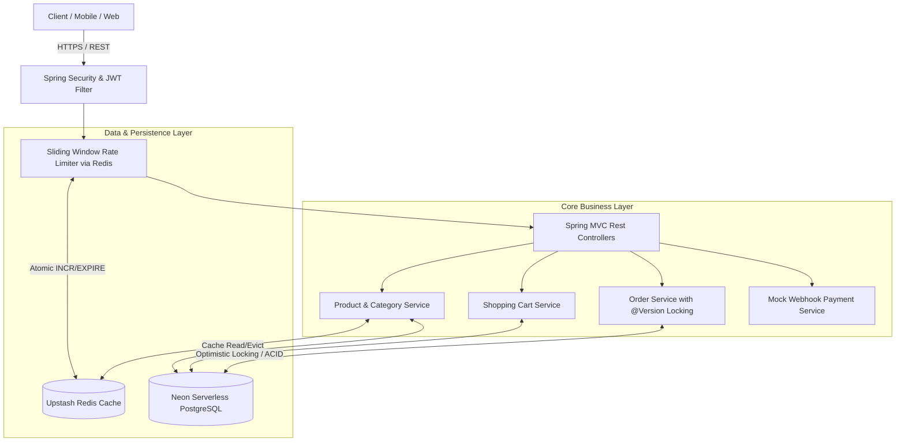
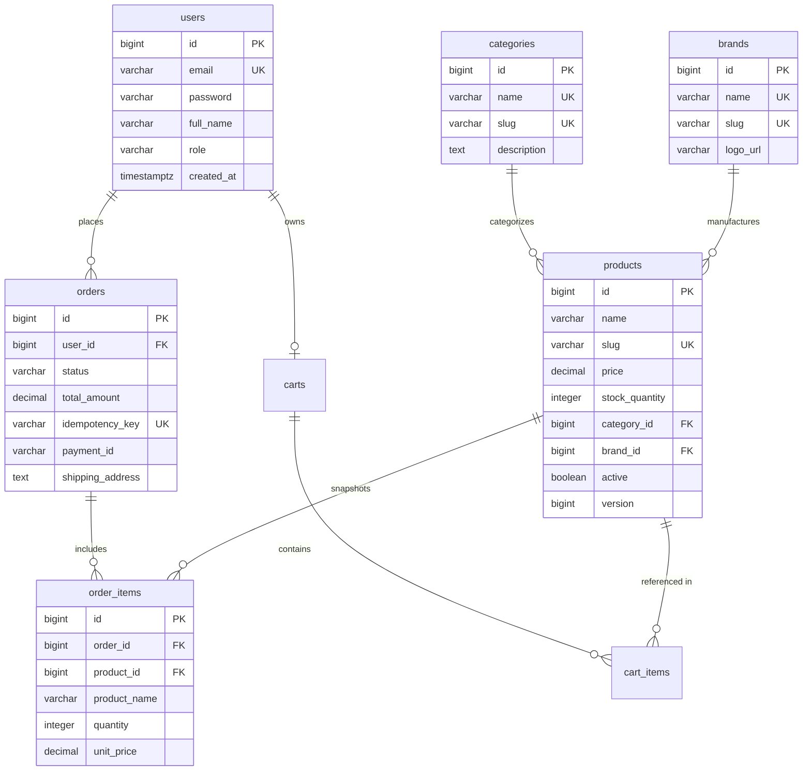

# GlowCart — Beauty E-Commerce High-Concurrency Backend

[](https://github.com/NotMayankfr/GlowCart/actions)


> High-throughput, production-grade beauty e-commerce backend built to solve real-world architectural challenges modeled after Nykaa: high-concurrency flash sales, strict inventory reservation without overselling, idempotent checkout, and sub-100ms cached catalog responses.

---

## Architecture Overview



---

## Key Engineering Stories

### 1. Flash Sale Oversell Protection (Optimistic Locking)
During high-traffic flash sale events, hundreds of buyers attempt to purchase low-stock items simultaneously. 
* **Mechanism:** Rather than holding pessimistic database row locks (`SELECT FOR UPDATE`) that choke connection pools, GlowCart utilizes JPA `@Version` optimistic locking.
* **Database Query:**
  ```sql
  UPDATE products 
  SET stock_quantity = stock_quantity - 1, version = version + 1 
  WHERE id = ? AND version = ?;
  ```
* **Concurrency Verification:**
  Verified via [`OversellIntegrationTest.java`](src/test/java/com/glowcart/integration/OversellIntegrationTest.java):
  * **200 concurrent threads** fire simultaneously using `CountDownLatch` against a product with **10 units in stock**.
  * **Exactly 10 buyers succeed** (`201 CREATED`).
  * **Exactly 190 buyers receive conflict rejections** (`409 CONFLICT`).
  * **Remaining stock is strictly 0** — zero negative oversell under heavy contention.

### 2. Idempotent Order Creation
Network timeouts during order submission can trigger automated mobile client retries.
* Every checkout request requires a unique `Idempotency-Key: <UUIDv4>` HTTP header.
* If an order with the same key already exists, `OrderService` returns the existing order record without double-charging or deducting duplicate inventory.

### 3. Order Lifecycle State Machine
Orders transition strictly through valid lifecycle stages:
```
CREATED ──(Payment Callback)──> PAID ──(Admin Action)──> SHIPPED
   │                               │
   └──(Timeout / Failure)──────────┴──> CANCELLED (Inventory Automatically Restored)
```
* **Auto-Cancellation:** Stale orders lingering in `CREATED` status past 30 minutes are automatically identified by `@Scheduled` background worker and cancelled with full inventory replenishment.

### 4. Dual-Layer Caching & Rate Limiting
* **Product Detail Caching:** Hot product pages are cached in Redis with a 5-minute TTL. Stale entries are evicted automatically upon stock modification or administrative update.
* **Sliding Window Rate Limiter:** Applied on `POST /api/v1/orders` via `RateLimitFilter` using Redis atomic `INCR` + `EXPIRE` (10 requests/minute per authenticated user).

---

## Complete API Contract (19 Endpoints)

### Authentication
| Method | Endpoint | Access | Description |
|---|---|---|---|
| `POST` | `/api/v1/auth/register` | Public | Register customer account & receive JWT |
| `POST` | `/api/v1/auth/login` | Public | Authenticate credentials & receive JWT |

### Catalog Browsing & Administration
| Method | Endpoint | Access | Description |
|---|---|---|---|
| `GET` | `/api/v1/categories` | Public | List all product categories (Redis cached) |
| `GET` | `/api/v1/categories/{slug}` | Public | Get category details by URL slug |
| `POST` | `/api/v1/categories` | Admin | Create new category |
| `GET` | `/api/v1/brands` | Public | List all brands (Redis cached) |
| `GET` | `/api/v1/brands/{slug}` | Public | Get brand details by URL slug |
| `POST` | `/api/v1/brands` | Admin | Register new brand |
| `GET` | `/api/v1/products` | Public | Filtered, paginated product search |
| `GET` | `/api/v1/products/{slug}` | Public | Get single product (Redis cached) |
| `POST` | `/api/v1/products` | Admin | Create product |
| `PUT` | `/api/v1/products/{id}` | Admin | Update product & evict cache |
| `DELETE` | `/api/v1/products/{id}` | Admin | Soft-delete product (`active = false`) |

### Shopping Cart
| Method | Endpoint | Access | Description |
|---|---|---|---|
| `GET` | `/api/v1/cart` | Customer | Fetch current shopping cart and line items |
| `POST` | `/api/v1/cart/items` | Customer | Add product to cart with quantity |
| `PUT` | `/api/v1/cart/items/{itemId}` | Customer | Update item quantity in cart |
| `DELETE` | `/api/v1/cart/items/{itemId}` | Customer | Remove specific product from cart |
| `DELETE` | `/api/v1/cart` | Customer | Empty entire shopping cart |

### Orders & Checkout
| Method | Endpoint | Access | Description |
|---|---|---|---|
| `POST` | `/api/v1/orders` | Customer | Place order (Header: `Idempotency-Key: <UUID>`) |
| `GET` | `/api/v1/orders` | Customer | List paginated personal order history |
| `GET` | `/api/v1/orders/{id}` | Customer | View detailed order receipt and line items |
| `GET` | `/api/v1/admin/orders` | Admin | Browse all orders with optional status filter |
| `PUT` | `/api/v1/admin/orders/{id}/status` | Admin | Advance order lifecycle state |

### Asynchronous Webhooks
| Method | Endpoint | Access | Description |
|---|---|---|---|
| `POST` | `/api/v1/webhooks/payment` | Public | Mock payment gateway transaction callback |

---

## Database Schema (PostgreSQL Flyway)



---

## Running Locally

### Prerequisites
* JDK 17 or JDK 21
* Docker & Docker Compose (optional for local DB/Redis)

### 1. Start Database & Redis
```bash
docker compose up -d
```

### 2. Build and Run Backend
```bash
./mvnw clean spring-boot:run
```

### 3. Explore Interactive Swagger API Docs
Open your browser and navigate to:
```
http://localhost:8080/swagger-ui.html
```

---

## Running the Concurrency & Unit Tests
```bash
./mvnw test
```
All unit tests and the 200-buyer concurrency flash sale test execute in an isolated in-memory PostgreSQL-compatible environment.

---

